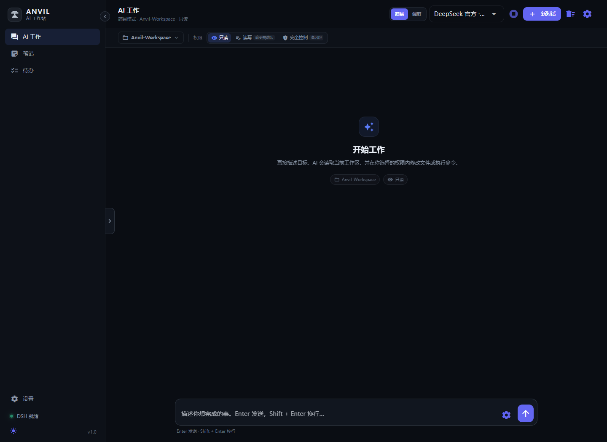
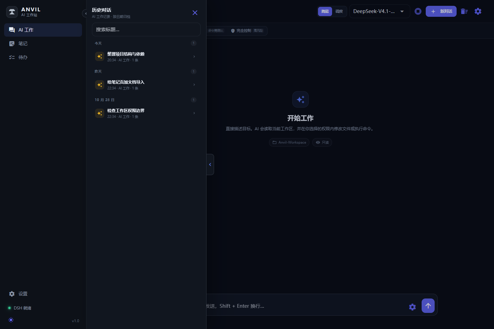
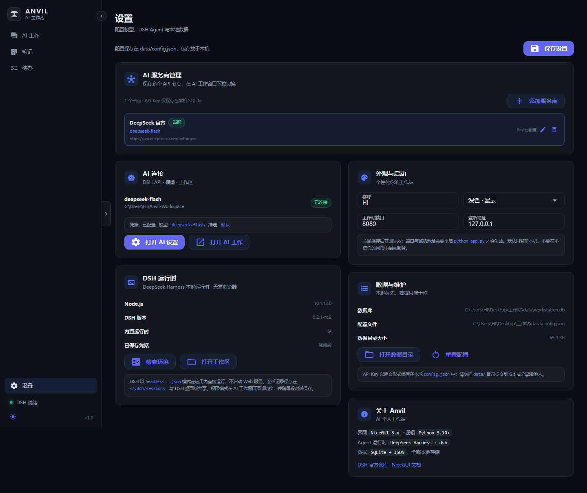
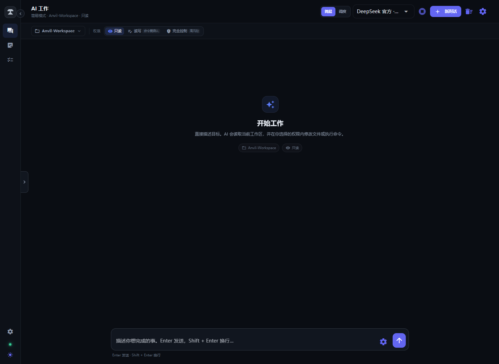

# Anvil · AI 个人工作站

一个 **Windows 桌面应用**，不是网页。界面使用 Python + [NiceGUI](https://nicegui.io)，打包为 `Anvil.exe`，并把 **DeepSeek Harness（DSH）** 内置在应用里。

打开后只有一个可折叠侧边栏和一个 **AI 工作** 窗口：描述目标，AI 会在你选择的工作区里读取文件、修改文件或执行命令。对话、工具调用和执行轨迹都在这一个窗口里完成，不再区分「普通对话 / Agent」。笔记、待办和设置收在侧边栏。









---

## 主要功能

| 模块 | 说明 |
| --- | --- |
| **AI 工作** | 单一窗口完成对话与执行；顶部选择工作区、权限和模型；模型从当前 API 自动检测；`Enter` 发送，`Shift + Enter` 换行 |
| **简易 / 调度模式** | 顶部一键切换。简易模式固定使用当前模型；调度模式按任务自动选择轻量或强模型，主力余额不足时自动切换备用模型 |
| **工作区** | 每个对话绑定一个目录，AI 只能在这个目录及其允许的子目录中工作 |
| **分级权限** | 只读 / 读写（命令需确认）/ 完全控制（风险确认后开启），并在核心层再次强制校验 |
| **执行轨迹** | 工具调用、参数、输出和成败状态以可展开卡片显示 |
| **文件快照与撤销** | 会修改文件的任务开始前自动保存工作区快照；结束后显示红绿 Diff，可「接受修改」或「撤销全部」 |
| **文档导入** | 把 Word / PDF / Excel 拖进笔记页，提取正文并让 AI 生成摘要，保存为 Markdown 笔记 |
| **多 AI 服务商** | 在设置页添加、编辑、删除多个 API 节点（名称 / Base URL / API Key / Model），主聊天下拉框手动切换；节点保存在 SQLite |
| **任务与笔记提醒** | 新建任务或笔记时可选择提醒时间；后台异步检查，到点后在窗口右上角弹出 Notification |
| **历史对话** | 左侧中部的小型 `>` 拉动按钮；打开后变为 `<`，点击可收回；按日期归档，支持搜索和继续 |
| **可折叠侧边栏** | 展开 250px / 折叠 60px 纯图标，平滑过渡，状态持久化到 `config.json` |
| **AI 设置** | Base URL、API Key、自动检测模型、调度角色、推理强度、工作区、DSH 已保存凭据 |
| **知识笔记** | Markdown 笔记，标签、搜索、实时预览、可选提醒 |
| **待办** | 优先级、截止日期、提醒、完成归档；完成/删除按钮，删除二次确认 |
| **本地优先** | 配置、对话、笔记和待办都在本机；API Key 不会上传到 Anvil 自己的服务器 |

---

## 权限模式

权限在 AI 工作窗口顶部切换，并随每段对话锁定。

| 模式 | DSH 权限 | 行为 |
| --- | --- | --- |
| **只读** | `read-only` | AI 可以读取工作区，但不能写入文件；需要写入或提权的操作会失败 |
| **读写 · 命令需确认** | `workspace-write` | 发送任务前先确认一次；AI 可以在工作区内修改文件。需要越过沙箱执行敏感命令时，应用会弹出 **「需要你的授权」** 窗口，由你选择「允许一次」或「拒绝」 |
| **完全控制 · 高风险** | `danger-full-access` | AI 可以修改任意有权限的文件、执行任意命令。开启前会弹出紧凑的风险确认，勾选「我已了解风险」后才能继续 |

- 「允许一次」只对当前操作有效，不会自动放宽后续操作。
- DSH 的 headless 模式没有原生交互审批界面；Anvil 通过本机回连桥把 DSH 的审批请求送到桌面窗口。
- 切换工作区或权限会开始一段新对话，避免 DSH 会话绑定到旧目录。

### 后端硬性安全边界

权限不只是界面按钮。每次任务进入 DSH 前，核心层都会再次检查：

1. 权限值统一映射为 DSH 的 `read-only` / `workspace-write` / `danger-full-access`，未知值直接降级为只读。
2. 工作区路径先经过 `os.path.normpath` 规范化，再用真实路径判断是否仍在工作区内；`../../`、绝对路径越界和符号链接逃逸都会被拒绝。
3. 只读模式下，写入、删除、移动和命令类工具在工具调用事件到达时直接拦截，不再等待 DSH 授权。
4. 所有 DSH 任务都有强制超时（默认 300 秒），超时会终止整个子进程；Node 版本检查等外部命令也有独立超时，避免桌面窗口无限挂起。
5. 工作区快照默认上限 256 MB，超大文件会跳过并在界面提示。

---

## DSH 是怎么内置的？

Anvil **没有**嵌入 DSH 的 Web 页面，而是直接驱动它的 headless 模式：

```text
NiceGUI 应用
   │  stdin: 任务文本
   ▼
node vendor/dsh/.../bin.js --patch data/dsh-headless.patch.yml \
     --profile headless --json [--session-id <id>]
   │  stdout: 逐行 JSON 事件
   ▼
session / thinking / text / tool_call / tool_result / final
   │
   ▼
AI 工作窗口：答案 + 可展开的执行轨迹
```

- **不启动 Web 服务**：没有 iframe，不占用 DSH 的 Web 端口。
- **会话延续**：首轮从 `session` 事件取得 `sessionId`，后续任务通过 `--session-id` 继续同一段 DSH 会话，历史保存在 `~/.dsh/sessions`。
- **权限映射**：应用把权限写入 `DSH_PERMISSION_MODE`，DSH 根据它设置 sandbox 与审批策略。
- **审批回连**：应用会生成一个很小的 Cordis 插件 `data/anvil_dsh_approval.mjs`，通过带随机令牌的本机 HTTP 端点 `/api/dsh/approval` 把审批请求转给界面。令牌每次启动都会重新生成。
- **凭据**：优先使用「AI 设置」里的 Key；也可以开启「使用 DSH 已保存的凭据」，复用 `~/.dsh` 中的 DSH 登录信息。
- **完全离线启动**：打包版内置便携 Node.js 与 DSH npm 包，目标电脑不需要安装 Node.js，也不会在首次运行时联网下载依赖。

> DSH 会真实读写工作区文件、执行命令。**请把工作区指向专用项目目录，不要指向系统目录或重要资料目录。**

---

## 模型自动检测

- 打开 **AI 设置** 时，Anvil 会从当前 Base URL 推导 `/models` 地址并自动查询。
- 支持普通 API Key（`Authorization: Bearer` / `x-api-key`）和 DSH 桌面版保存的登录令牌（`x-dsh-auth-token`）。
- 检测结果会缓存到本地，下次打开直接复用；连接信息改变或点击「检测模型」会重新查询。
- **没有硬编码的默认模型**。如果接口不可用，界面会提示原因，也可以直接手动填写模型 ID；未选择模型时不会启动任务。
- DSH 使用 Anthropic Messages 端点（默认 `https://api.deepseek.com/anthropic`），但模型列表走同源 `/models` 接口。

---

## 模型调度（简易 / 调度）

AI 工作窗口顶部有一个 **「简易 / 调度」** 开关，状态保存在 `data/config.json` 的 `dsh.router.mode`。

- **简易模式（Direct）**：始终使用 AI 设置里选中的当前模型。
- **调度模式（Router）**：根据任务内容自动选择模型。代码、调试、文件修改、命令和较长的工程描述走「强模型任务」；闲聊、总结、翻译等走「轻量任务」。
- 检测到模型后，Anvil 会用当前 API 返回的真实模型自动填充三个角色：轻量、强模型、备用。可以随时在 AI 设置中修改，不会写死任何模型名。
- 如果主模型返回 `Insufficient Balance`、`insufficient_quota`、`余额不足` 或 HTTP 402，且本轮还没有产生文本或工具调用，会自动用备用模型重试一次。
- 每次回答的轨迹标题会显示本次使用的模型；调度角色可以在 AI 设置中调整。

---

## 文档导入与笔记

在 **笔记** 页点击「导入文档」，把文件拖进上传区域：

| 格式 | 读取方式 |
| --- | --- |
| PDF（`.pdf`） | `pypdf` 逐页提取文字，最多 300 页 |
| Word（`.docx`） | `python-docx` 读取段落与表格 |
| Excel（`.xlsx` / `.xlsm`） | `openpyxl` 只读模式读取工作表，最多 20 个表、每表 2000 行 |
| 文本（`.txt` / `.md` / `.csv`） | 自动尝试 UTF-8 / GB18030 / UTF-16 |

文件限制 25 MB，正文最多 12 万字符。上传后 Anvil 会调用调度模式中的轻量模型生成中文摘要，并保存为带「文档 / AI摘要」标签的 Markdown 笔记。AI 不可用时仍会保存原文摘录和「待总结」标签，稍后可以重试。

导入使用临时文件和临时空工作区，文档分析任务始终是只读权限。

---

## 文件快照与 Diff 撤销

在「读写」或「完全控制」权限下，每次任务真正启动前，Anvil 会把工作区复制到 `data/snapshots/<时间>-<随机 ID>/`：

1. 任务结束后，用 `difflib` 比较快照和当前文件。
2. 有变化时弹出窗口，左侧选择文件，右侧显示绿色新增行和红色删除行。
3. 点击 **「接受修改」** 删除快照，保留 AI 的修改。
4. 点击 **「撤销全部」** 恢复原文件，并删除任务期间新建的文件。

快照会跳过 `.git`、`.venv`、`node_modules`、`vendor`、`dist`、`build` 等目录；超过 7 天的旧快照会在启动时自动清理。

---

## 快速开始（源码运行）

### 环境

- Python 3.10+（推荐 3.13）
- Windows 10/11（打包目标）
- 源码运行可选 Node.js 18+；如果要使用内置运行时，先执行 `python scripts/prepare_vendor.py`

### 启动

```bat
python -m venv .venv
.venv\Scripts\python.exe -m pip install -r requirements.txt

REM 开发时用浏览器
.venv\Scripts\python.exe app.py

REM 直接以桌面窗口运行
.venv\Scripts\python.exe app.py --native
```

或双击 `run.bat`（首次会自动创建虚拟环境并安装依赖）。

### 首次配置

1. 打开 AI 工作窗口右上角的 **齿轮**（或进入「设置」）。
2. 填写 API Base URL 和 API Key；DSH 使用 Anthropic Messages 兼容端点，留空时默认 `https://api.deepseek.com/anthropic`。
3. 窗口打开后会自动检测当前 API 的模型；也可以点击「检测模型」重新查询，然后选择模型和推理强度。推理强度可选「默认 / 关闭 / 低 / 高 / 最高」。
4. 选择工作区。AI 只能在这个目录中读写文件。
5. 回到 AI 工作窗口，从「只读」开始，输入任务，例如：

```text
只读：总结当前工作区的项目结构，列出主要文件及用途，不要修改任何文件。
```

确认流程正常后，再按需切换到「读写」或「完全控制」。

---

## 构建 EXE

```bat
build.bat
```

或手动：

```bat
.venv\Scripts\python.exe -m pip install -r requirements-build.txt
.venv\Scripts\python.exe scripts\prepare_vendor.py
.venv\Scripts\python.exe scripts\build_exe.py
```

产物：

```text
dist\Anvil\Anvil.exe          ← 双击启动桌面窗口
dist\Anvil\_internal\         ← 依赖与内置 DSH / Node
dist\Anvil\data\              ← 首次运行后生成（配置、SQLite）
```

**分发时请压缩整个 `dist\Anvil` 目录**（onedir 启动快，比 onefile 稳定）。
内置 DSH 依赖较多，完整目录约 1 GB。

构建脚本会：

1. `scripts/prepare_vendor.py`：复制便携 `node.exe`，用 npm 安装固定版本 `@deepseek-ai/dsh@0.2.1-rc.2` 到 `vendor/`；
2. `scripts/make_icon.py`：生成应用图标；
3. 直接调用 PyInstaller，打包为无控制台窗口的桌面程序。

---

## 数据目录

| 内容 | 位置 |
| --- | --- |
| Anvil 配置 | `data/config.json`（源码运行：项目根目录；EXE：exe 同级 `data/`） |
| 对话 / 笔记 / 待办 / AI 服务商 / 提醒 / DSH 会话索引 | `data/workstation.db`（SQLite） |
| DSH 会话与凭据 | `~/.dsh/`（与 DSH 桌面版共享） |
| DSH 默认工作区 | `~/Anvil-Workspace`（可随时在设置中修改） |
| DSH 审批插件与补丁 | `data/anvil_dsh_approval.mjs`、`data/dsh-headless.patch.yml` |
| EXE 日志 | exe 同级 `data/anvil.log`、`data/crash.log` |

> `data/` 已被 `.gitignore` 忽略。API Key 以明文保存在本地配置文件中，请不要把 `data/` 提交到 Git 或分享给他人。

---

## 项目结构

```text
app.py                     应用入口（原生窗口 / 浏览器 / 打包区分）
core/
  settings.py              JSON 配置、默认值与点号读写
  db.py                    SQLite：DSH 会话/消息、笔记、待办、AI 服务商、提醒与旧数据迁移
  ai_providers.py          多 AI 服务商节点选择与 DSH 运行时同步
  reminders.py             提醒时间解析、后台异步检查与右上角通知
  dsh_agent.py             DSH headless --json 驱动、会话延续、权限与凭据注入
  security.py              权限硬校验、工作区路径规范化与工具调用拦截
  model_catalog.py         从当前 API 的 /models 自动检测并缓存模型
  model_router.py          简易 / 调度模式、任务分类、主备降级
  snapshots.py             工作区快照、difflib Diff 与整体撤销
  documents.py             Word / PDF / Excel / 文本提取
  doc_ai.py                用 DSH 生成文档摘要
  approval.py              DSH 审批回连桥与 Cordis 插件
  runtime.py               源码 / PyInstaller 路径解析
  system.py                文件夹选择、目录大小等系统能力
ui/
  theme.py                 主题、CSS、可折叠侧边栏、历史抽屉
  ai_settings.py           AI 设置：连接、模型、推理强度、工作区
  pages/
    chat.py                AI 工作（/、/chat、/dsh 别名）
    notes.py               笔记
    tasks.py               待办
    settings_page.py       设置
scripts/
  prepare_vendor.py        下载 / 安装内置 Node + DSH
  build_exe.py             PyInstaller 打包
  make_icon.py             生成 ico
tests/                     页面与审批链路冒烟测试
vendor/                    内置 node.exe 与 DSH（不提交 Git）
```

---

## 开发与测试

```bat
.venv\Scripts\python.exe -m pytest -q
```

测试使用 NiceGUI 的 User 模拟器，不启动真实浏览器；审批测试使用假的 DSH 事件流验证「任务确认 → 审批弹窗 → 允许一次」链路。真实 DSH 任务需要模型凭据，测试中不会自动调用。

开发模式：

```bat
.venv\Scripts\python.exe app.py --reload
```

> `--reload` 仅建议在浏览器模式使用；原生窗口模式请关闭 reload。

---

## 常见问题

**Q：为什么 EXE 启动后没有控制台？**
打包使用 `--windowed`，日志写入 `data/anvil.log`；启动崩溃会写入 `data/crash.log` 并弹窗提示。

**Q：DSH 提示 API Key 无效？**
检查「AI 设置」中的 Key 和 Base URL；或者关闭「使用 DSH 已保存的凭据」，让 DSH 使用 Anvil 里填写的 Key。

**Q：模型列表是空的 / 检测失败？**
先确认 Base URL 与 API Key 正确。Anvil 会尝试 `Base URL 同源 + /models`；如果第三方服务没有实现 `/models`，可以直接在模型下拉框输入模型 ID。账户只有 DSH 登录令牌时，请保持「使用 DSH 已保存的凭据」开启。

**Q：读写模式下为什么没有每条命令都弹窗？**
DSH 的沙箱会先允许工作区内的常规读写；只有需要提升权限、越过沙箱的操作才会请求授权。发送任务前的那次确认代表你允许启动这次任务，具体敏感操作仍会单独弹窗。

**Q：DSH 任务执行到一半，可以停止吗？**
可以，AI 工作窗口右上角的停止按钮会结束当前进程；已生成的答案与轨迹会保存。

**Q：应用窗口关闭后 DSH 还在跑吗？**
关闭窗口会触发应用退出并结束当前 DSH 子进程；主动离开 AI 工作页面也会停止当前任务并保存已产生的输出。

**Q：侧边栏收起来后怎么展开？**
点击侧边栏顶部的箭头按钮；收起状态会保存，下次打开仍然生效。

**Q：历史对话在哪里？**
在内容区左侧中部的 `>` 小拉动条；点击打开，按钮变为 `<`，再点击收回。

---

## 许可

本项目代码使用 MIT License。内置的 DeepSeek Harness 为 MIT 协议，版权归 DeepSeek AI 所有；详见 `THIRD_PARTY_NOTICES.md`。
